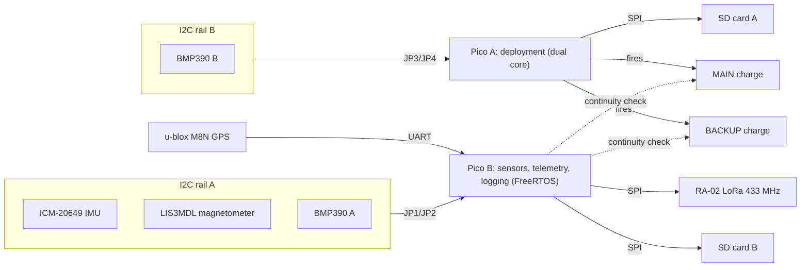
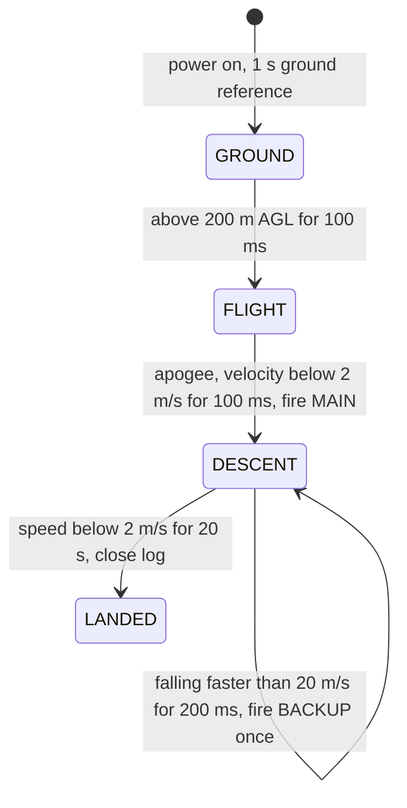

# Astro Avionics: VADA Flight Computer

[](https://github.com/The-Stargazist/astro-avionics/actions/workflows/firmware.yml)

Dual-computer avionics for amateur and student rockets. The **VADA** board
carries two Raspberry Pi Pico 2 microcontrollers that fly independently:

- **Pico A** watches its own barometer and deploys the parachute.
- **Pico B** reads every sensor and the GPS, sends live LoRa telemetry and
  keeps a detailed log.

Each computer has its own barometer, I2C bus and SD card, so a failure on one
does not take down the other.

> [!WARNING]
> This system controls pyrotechnic charges. The firmware has been rebuilt and
> tested in simulation, but **has not yet flown or been bench-tested on the
> VADA board**. Read [Known issues](#known-issues) and bench-test every pyro
> channel before any flight.

---

## Contents

- [How it works](#how-it-works)
- [Hardware](#hardware)
- [Flight sequence](#flight-sequence)
- [Getting started](#getting-started)
- [Pre-flight checklist](#pre-flight-checklist)
- [Flight data](#flight-data)
- [Repository layout](#repository-layout)
- [Known issues](#known-issues)
- [History](#history)
- [Credits and license](#credits-and-license)

---

## How it works



| | Pico A: deployment | Pico B: sensors and telemetry |
|---|---|---|
| Barometer | BMP390 "B" (rail B) | BMP390 "A" (rail A) |
| Other sensors | — | ICM-20649 IMU, LIS3MDL magnetometer, GPS |
| Fires pyro charges | **Yes**: MAIN at apogee, BACKUP on overspeed | No (outputs held low) |
| Continuity checks | MAIN, BACKUP, MOTOR, STAGE, check loop | MAIN, BACKUP |
| Logging | SD card A, 50 Hz, `flightNNN.csv` | SD card B, 50 Hz, `telemNNN.csv` |
| Telemetry | — | LoRa, 4 packets/s |
| Runtime | Core 0 flies, core 1 writes the SD card | FreeRTOS tasks |

Both boards run the same flight-phase logic on their own barometer. Pico A
acts on it; Pico B reports it in its log and telemetry. Neither board ever
waits on the SD card or USB while making flight decisions.

## Hardware

The KiCad project for the VADA PCB is in [`vada/`](vada). Everything below
was read from `vada/VADA.kicad_pcb`.

| Part | Function | Connected to |
|------|----------|--------------|
| 2 × Raspberry Pi Pico 2 (RP2350) | Flight computers A and B | — |
| 2 × BMP390 | Barometric altitude | One per I2C rail |
| ICM-20649 | 6-axis IMU, ±30 g / ±2000 °/s | Rail A (Pico B) |
| LIS3MDL | 3-axis magnetometer | Rail A (Pico B) |
| u-blox M8N | GPS | Pico B UART1 (GPIO8/9) |
| Ai-Thinker RA-02 (SX1278) | 433 MHz LoRa radio | Pico B SPI0 |
| 2 × microSD socket | Data logging | One per Pico, SPI0 |
| 4 × CPC1020N solid-state relay | Pyro channels | See below |
| NCP1117-3.3 | 3.3 V regulator from the 5 V input (J1) | — |

**Pyro channels.** Each channel has three lines: TRIG switches battery
power (J7) to the e-match, CONT sends a tiny test current through it, and
SENSE reads it back.

| Channel | Connector | Wired to | Firmware use |
|---------|-----------|----------|--------------|
| MAIN | J2 "Pyro 3" | Both Picos (diode-OR) | Fired by Pico A at apogee |
| BACKUP | J3 "Pyro 4" | Both Picos (diode-OR) | Fired by Pico A if descending too fast |
| MOTOR | J5 "Pyro 1" | Pico A only | Held off, continuity reported |
| STAGE | J6 "Pyro 2" | Pico A only | Held off, continuity reported |

The full pin map for both boards is in
[`firmware/lib/board/VadaPins.h`](firmware/lib/board/VadaPins.h).

## Flight sequence



1. **Ground reference.** At power-on each board takes the median of 1 s of
   barometer readings as "pad altitude". All altitudes after that are above
   ground level (AGL).
2. **Filtering.** Raw barometer readings are noisy. A filter smooths them
   into altitude and vertical speed, and throws away single readings that
   are more than 50 m off (a corrupted sensor read).
3. **Launch.** Above 200 m AGL the board switches to FLIGHT. While on the
   ground, Pico A re-checks continuity every second.
4. **Apogee.** When the rocket stops climbing, Pico A fires MAIN for 500 ms.
5. **Overspeed.** If the rocket then falls faster than 20 m/s (main
   failed), Pico A fires BACKUP for 1 s and then MAIN again. This check is
   ignored for the first 2 s after apogee, because the ejection charge
   briefly upsets the barometer.
6. **Landing.** After 20 s with almost no vertical movement, Pico A closes
   its log file.

Every transition has to hold over time, so one bad reading can't trigger it.
All thresholds are in `FlightConfig` in
[`firmware/lib/flight/FlightComputer.h`](firmware/lib/flight/FlightComputer.h).

## Getting started

### Prerequisites

- [PlatformIO](https://platformio.org): either the VS Code extension or the
  command line (`pip install platformio`)
- `gcc` and `g++` on your `PATH` to run the unit tests (on Windows, MSYS2
  or MinGW)

### Build

```bash
git clone https://github.com/The-Stargazist/astro-avionics.git
```

```bash
cd astro-avionics/firmware
```

```bash
pio run
```

The first build downloads the RP2350 toolchain, which takes a few minutes.

### Flash

Connect one Pico at a time over USB. If the upload can't find the board,
unplug it, hold the **BOOTSEL** button and plug it back in.

```bash
pio run -e pico_a -t upload
```

```bash
pio run -e pico_b -t upload
```

Watch the output over USB (Pico A prints its log, Pico B prints a status line
every second):

```bash
pio device monitor
```

### Test

```bash
pio test -e native
```

This runs 22 tests on your computer, no hardware needed:

- simulated flights: normal, failed main, sensor glitches
- GPS sentence parsing
- barometer maths against Bosch's reference values

GitHub Actions runs the tests and both builds on every push.

### Board setup

**Bridge all four solder jumpers JP1, JP2, JP3 and JP4.** They connect
rail A to Pico B and rail B to Pico A. Without them neither board can see its
barometer.

## Pre-flight checklist

1. JP1–JP4 bridged. Two FAT32-formatted microSD cards inserted.
2. Power on **at the launch site**. The pad altitude is measured in the
   first second, so powering on somewhere else shifts every altitude.
3. Check both status LEDs:

   | LED | Meaning |
   |-----|---------|
   | 1 Hz blink | Ready |
   | Solid | MAIN or BACKUP e-match not detected |
   | 5 Hz blink | Sensor, SD card or (Pico B) radio fault |

4. Confirm telemetry is arriving. The `flags` field should show barometer,
   IMU, magnetometer, SD and radio OK, MAIN and BACKUP continuity, and a GPS
   fix (needed for recovery).
5. Check the e-matches are connected before final arming. Pico A re-checks
   continuity every second until launch.

## Flight data

| | Pico A | Pico B |
|---|---|---|
| File | `flightNNN.csv` | `telemNNN.csv` |
| Rate | 50 Hz | 50 Hz |
| Columns | time, pressure, temperature, raw and filtered altitude, velocity, phase | All of Pico A's, plus IMU, magnetometer, GPS and health flags |

A new file is created at every power-on, and data is flushed to the card ten
times a second. Lines starting with `#` are events (launch, apogee, faults);
load the files with `pandas.read_csv(path, comment="#")`.

**Telemetry** (Pico B, LoRa 433 MHz, SF7) is one plain-text line per packet:

```
VADA,time_ms,phase,alt_m,vel_mps,max_alt_m,lat,lon,sats,flags
```

The column definitions and the `flags` bits are in
[`firmware/README.md`](firmware/README.md).

## Repository layout

```
firmware/              current flight software (PlatformIO project)
  src/pico_a/          Pico A application
  src/pico_b/          Pico B application
  lib/board/           pin map for both boards
  lib/flight/          filter, ground reference, flight phases (pure C++, unit-tested)
  lib/gps/             NMEA GPS parser (pure C++, unit-tested)
  lib/sensors/         BMP390, ICM-20649, LIS3MDL drivers
  lib/pyro/            continuity test and firing
  lib/logging/         non-blocking log buffer, SD file naming
  test/                host unit tests
  tools/               MicroPython bring-up script for Pico B
vada/                  VADA PCB: KiCad schematic, layout, 3D model
dosa-2025/             previous flight computer (archived)
```

Technical detail for developers (task layout, file formats, tuning) is in
[`firmware/README.md`](firmware/README.md).

## Known issues

- **Pyro drive current may be too low (hardware).** By the resistor values
  in the PCB file, each solid-state relay gets only about 10–40 µA to switch
  on, but the CPC1020N needs milliamps. If those values are what's fitted,
  the charges may never fire. Bench-test every channel with an e-match
  substitute.
- **No hardware test yet.** The rebuilt firmware compiles and passes its
  simulations, but has not run on a VADA board.
- **Pico A relies on one barometer.** If it fails mid-flight there is no
  timer-based fallback deployment.
- **Only Pico A fires.** The hardware lets Pico B fire MAIN and BACKUP too,
  as a redundant second deployment computer. The firmware doesn't use that.
- **Pico-to-Pico link unused.** The boards are connected by a UART (GPIO0/1)
  that the firmware does not use yet.
- **Barometer labels.** In the schematic the barometers are labelled
  BMP585, but the footprints and firmware are for the BMP390.

## History

- **2025: DOSA** ([`dosa-2025/`](dosa-2025)). Arduino Nano ESP32 for flight
  control plus a Raspberry Pi for logging, camera and backup deployment.
  Archived for reference, not maintained.
- **VADA.** Custom dual-Pico PCB. Separate Pico A and Pico B projects were
  merged into one tested firmware project in `firmware/`.

## Credits and license

This project uses code from Astro Avionics Flight Computer. This fork
(The-Stargazist/astro-avionics) is based on
[YogPanjarale/astro-avionics](https://github.com/YogPanjarale/astro-avionics)
and its contributors.

Released under the MIT License with an attribution requirement: if you use,
modify or distribute this code, credit the original authors. See
[`LICENSE`](LICENSE) for the full terms.
